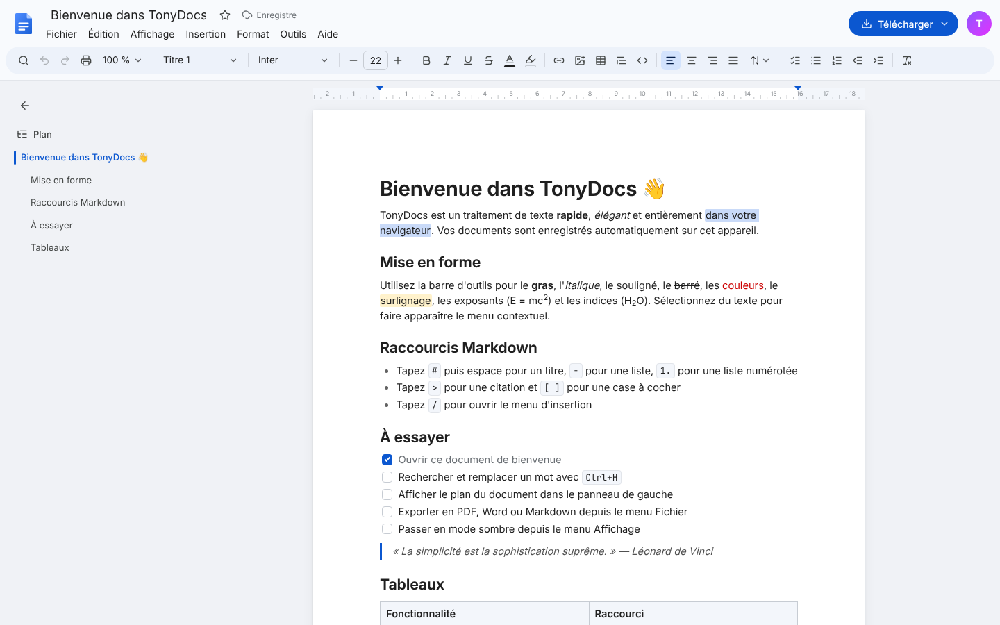
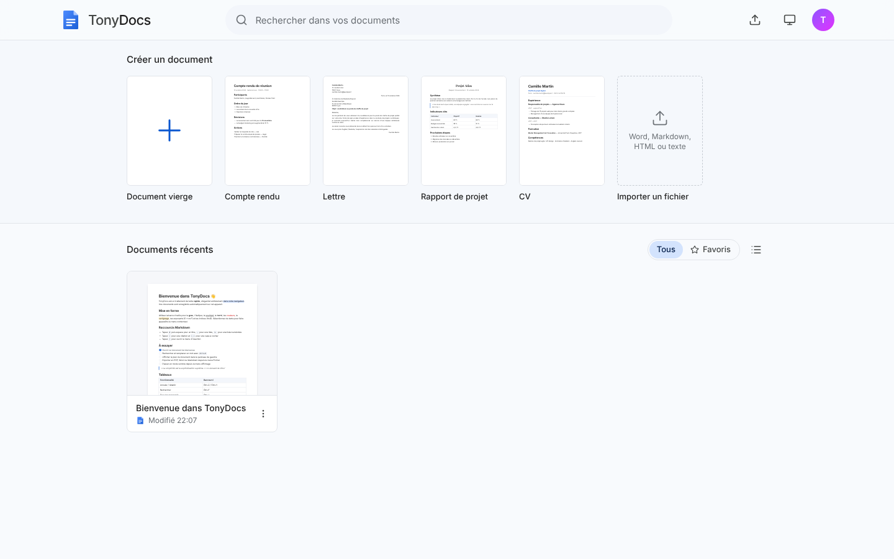
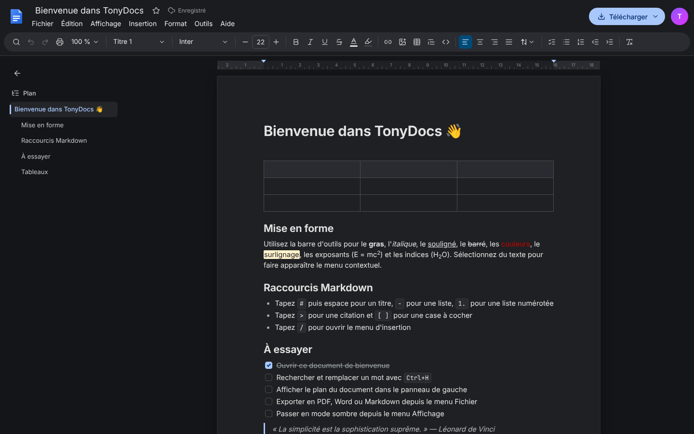

# TonyDocs

Un traitement de texte moderne, rapide et élégant qui fonctionne entièrement dans le navigateur. Une alternative légère à Word et Google Docs.



| Accueil | Mode sombre |
|---|---|
|  |  |

## Fonctionnalités

**Écriture**
- Page A4 avec règle, zoom (50 à 200 %) et plan du document cliquable
- Barre de menus complète (Fichier, Édition, Affichage, Insertion, Format, Outils, Aide) et barre d'outils façon Google Docs
- Styles de paragraphe, 11 polices, tailles, couleurs, surlignage, exposant/indice
- Alignement, interligne, retraits (Tab / Maj+Tab)
- Listes à puces, numérotées et de tâches ; citations ; blocs de code
- Tableaux (sélecteur de dimensions, fusion de cellules, redimensionnement des colonnes)
- Images : import, glisser-déposer, coller, redimensionnement
- Menu contextuel sur la sélection, aperçu des liens, menu « / » pour insérer des éléments
- Raccourcis Markdown (`#`, `-`, `1.`, `>`, `[ ]`…)
- Rechercher et remplacer avec surlignage de toutes les occurrences
- Nombre de mots (dialogue et compteur flottant)

**Documents**
- Accueil avec galerie de modèles (compte rendu, lettre, rapport, CV) et miniatures réelles des documents
- Enregistrement automatique (IndexedDB), favoris, recherche, renommage, copie, suppression avec annulation
- Export : Word (.docx), PDF, Markdown, HTML, texte
- Import : Word (.docx), Markdown, HTML, texte
- Thème clair, sombre ou système

## Stack

[Vite](https://vite.dev) · React 19 · TypeScript · [Tiptap 3](https://tiptap.dev) (ProseMirror) · Tailwind CSS 4 · `docx` / `mammoth` pour Word · `idb` pour le stockage local.

## Démarrer

```bash
npm install
npm run dev        # http://localhost:5173
npm run build      # build de production dans dist/
npm run typecheck
npm test           # tests unitaires et de sécurité (Vitest)
```

## Sécurité

L'application n'a ni serveur ni compte : les documents restent dans le navigateur (IndexedDB). Le contenu externe (fichiers importés, HTML collé, documents stockés) est traité comme non fiable :

- **Validation par liste blanche** (`src/lib/sanitize.ts`) de toute valeur écrite dans un `href`, un `src` ou un `style` : liens limités à http(s), mailto et tel ; images à http(s), blob et data:image ; couleurs, tailles, polices et interlignes validées. Elle s'applique à l'entrée (import, collage, chargement) **et** au rendu (extensions Tiptap durcies), en défense en profondeur.
- **Content-Security-Policy** injectée au build : aucun script en ligne ni externe, pas d'`eval`, pas d'iframe ni de plugin. Politique `no-referrer` pour les images distantes.
- **Limites** : 25 Mo par fichier importé, 20 Mo par image, formats contrôlés.
- **Erreurs d'enregistrement** signalées à l'utilisateur, avec nouvel essai automatique et alerte avant de quitter la page s'il reste des modifications non enregistrées.
- **Chaîne d'approvisionnement** : actions GitHub épinglées par SHA, Dependabot, `npm audit` en CI sur les dépendances livrées.
- **Tests de non-régression** (`tests/`) avec des fichiers piégés (HTML, Markdown, Word) dans `tests/fixtures/`.

## Déploiement

Le workflow `.github/workflows/deploy.yml` publie automatiquement l'application sur GitHub Pages à chaque push sur `main`.
Pour l'activer : **Settings → Pages → Source : GitHub Actions**. GitHub Pages nécessite un dépôt public, ou un compte GitHub Pro pour un dépôt privé.

## Architecture

```
src/
  editor/            Configuration Tiptap et extensions maison
    extensions/      Interligne, retraits, rechercher-remplacer, commandes « / »
  components/
    home/            Accueil : modèles, liste des documents, miniatures
    editor/          Page d'édition : menus, barre d'outils, plan, règle, dialogues
    ui/              Primitives : popovers, menus, infobulles, modales, notifications
  lib/               Stockage, routage, import/export, modèles, thème
```

Vos documents restent dans le navigateur de l'appareil : aucun serveur, aucun compte.

## Licence

Code distribué sous licence [MIT](LICENSE).

Les polices embarquées (Inter, Lora, Roboto Flex, Playfair Display, JetBrains Mono, Source Serif 4, via [Fontsource](https://fontsource.org)) restent sous leur propre licence, la [SIL Open Font License 1.1](https://openfontlicense.org).
